# Part 3: Beyond asyncio.gather(): Fail-Fast Requests with TaskGroup and the LSEG Data Library

## Overview

This article is a sequel to my [Concurrent Requests with Asyncio Gather and Data Library for Python](./Article_Gather.md) article. In Part III, we move from requesting multiple RICs concurrently with the LSEG Data Library for Python Historical Pricing `get_data_async` method using `asyncio.gather()` to the modern (Python 3.11+) `asyncio.TaskGroup` interface, which offers structured concurrency and a safer task lifecycle model.

**Note**: This article is based on the Data Library for Python version 2.1.1 using the Platform Session. The library behavior might change in future releases.

## (Recap) What is Python Asyncio? And how it relate to Data Library for Python

Before diving deeper, let’s quickly recap Python Asyncio and explore how it enables Data library for Python to perform asynchronous operations efficiently. Python [asyncio](https://docs.python.org/3/library/asyncio.html) is a library for writing concurrent code with `async/await`. The three most common concurrency interfaces are:

- [`asyncio.create_task(coro)`](https://docs.python.org/3/library/asyncio-task.html#asyncio.create_task) — wraps a [coroutine](https://docs.python.org/3/library/asyncio-task.html#coroutine) in a [Task](https://docs.python.org/3/library/asyncio-task.html#asyncio.Task) and schedules it for execution.
- [`asyncio.gather(*aws)`](https://docs.python.org/3/library/asyncio-task.html#asyncio.gather) — runs multiple [awaitables](https://docs.python.org/3/library/asyncio-task.html#asyncio-awaitables) concurrently and returns their results.
- [`asyncio.TaskGroup`](https://docs.python.org/3/library/asyncio-task.html#task-groups) — a modern (Python 3.11+) structured-concurrency API that manages a group of tasks together, ensuring all finish before the block exits.

This article shows how to use the [Data Library for Python](https://developers.lseg.com/en/api-catalog/lseg-data-platform/lseg-data-library-for-python) Historical Pricing `get_data_async` method to fetch multiple RICs concurrently using `asyncio.TaskGroup`.

This article uses a *Platform Session*. For other session types, see the [Data Library Quickstart](https://developers.lseg.com/en/api-catalog/lseg-data-platform/lseg-data-library-for-python/quick-start).

## (Recap) What are Synchronous and Asynchronous Execution Models?

That bring us to the next step, a briefly recap the synchronous and asynchronous execution models as follows.

**Synchronous** code runs tasks one at a time — each request must complete before the next one starts. The program blocks and waits at every I/O-bound call, so if a request takes 60 seconds, nothing else runs for those 60 seconds. Fine for a single request, but a real bottleneck when fetching data with many calls.

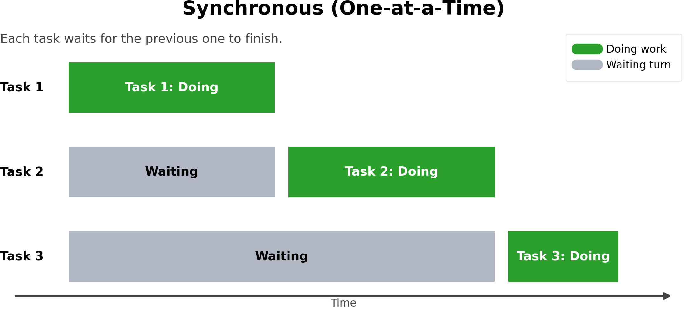

**Asynchronous** code lets multiple tasks run concurrently. While one request is waiting for a network response, the event loop hands control to the next task instead of sitting idle.

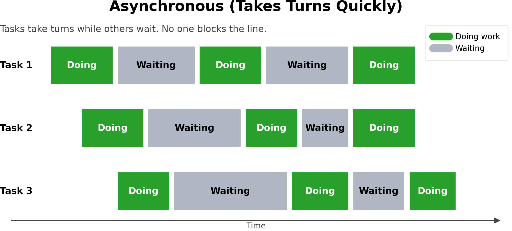

The real payoff comes when you have **many requests to make**. With `asyncio.gather()` and `asyncio.TaskGroup()`, all requests are fired concurrently so the total time is roughly that of the single slowest response — not the sum of all response times.

That covers the basic of synchronous and asynchronous executions.

## (Recap) Throttling and Rate Limits 

My next point is the API calls rate limits. The Data Platform API request limits (throttles) to effectively manage and protect its service and ensure fair usage across the non-streaming content. 

An application would receive an error from the API call if an application reached or exceeds a limit (especially with the Asynchronous HTTP calls). You required to make some necessary adjustments to rectify the interaction with the API and retry the respective API call. 

Two different server errors on API request limits are: 

| **HTTP Status** | **Detail** |
| --- | --- |
| **429** | **Error Message**: too many attempts |
|  | **Description**: A per account limit where the number of requests per second is limited for each account accessing the platform. If this limit is reached, applications will receive a standard HTTP error (HTTP 429 too many requests). |
|  | **Suggestion**: Please reduce the number of requests per second and retry. |

Please find more detail regarding the Data Platform HTTP error status messages from the [RDP API General Guidelines](https://developers.lseg.com/en/api-catalog/refinitiv-data-platform/refinitiv-data-platform-apis/documentation) document page.

The Historical Pricing endpoint rate limits information is available on the **Reference** tab of the [Data Platform API Playground](https://apidocs.refinitiv.com/Apps/ApiDocs) page. The current rate limits (**As of Mar 2026**) is as follows:

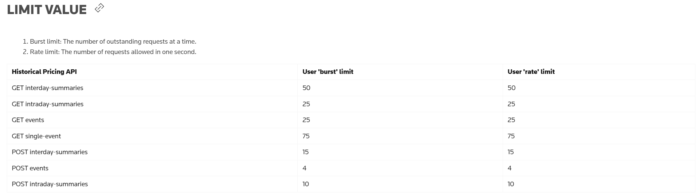

## Prerequisite

The basic knowledge of Python Asyncio library is required before proceeding. You can learn the basic of asyncio from the following resources:

- [Python's asyncio: A Hands-On Walkthrough](https://realpython.com/async-io-python/)
- [Asyncio Architecture in Python: Event Loops, Tasks, and Futures Explained](https://dev.to/imsushant12/asyncio-architecture-in-python-event-loops-tasks-and-futures-explained-4pn3)
- [A Conceptual Overview of asyncio](https://docs.python.org/3/howto/a-conceptual-overview-of-asyncio.html)
- [Python Asynchronous I/O](https://docs.python.org/3/library/asyncio.html)

**Requirements**

Make sure you have the following set up:

- Python 3.11+
- LSEG Data Platform credentials with Historical Pricing permission:
  - Machine ID
  - Password
  - AppKey

Please your LSEG representative or account manager for the Data Platform Access.

**Do I need to understand Asyncio.Gather before proceeding this example?**

No, you don't. However, if you understand both approaches, you can choose which one is better for your application and business requirements.

That’s all I have to say about this article and example code prerequisite.

## Code Walkthrough

Now we come to the code walkthrough. This article focuses primarily on the asynchronous code.

The first step is to import the required libraries. The main libraries are `lseg.data` and `asyncio`.

### Import Required Libraries

```python
import os
import asyncio
from IPython.display import Markdown, display
import lseg.data as ld
from lseg.data import session
from lseg.data.content import historical_pricing
from lseg.data._errors import LDError
from lseg.data.content.historical_pricing import Adjustments, Intervals
from dotenv import load_dotenv
import pandas as pd
pd.set_option("future.no_silent_downcasting", True)
```

### Open a Platform Session

Moving on to the next step, create a Data Library session object to authenticate, manage the connection, and retrieve data.

The code below gets the Data Platform credential from the OS environment variables. You can use the [python-dotenv](https://pypi.org/project/python-dotenv/) library to load credentials from `.env` file as well.

```python

# Retrieve Platform Session credentials from environment variables
app_key = os.getenv('LSEG_API_KEY')
username = os.getenv('LSEG_MACHINE_ID')
password = os.getenv('LSEG_PASSWORD')
# Create a platform session with provided credentials for authentication
ld_session = session.platform.Definition(
         app_key=app_key,
         grant=session.platform.GrantPassword(
             username=username,
             password=password
         ),
         signon_control=True
).get_session()

# Set this session as the default for all subsequent Data Library calls
session.set_default(ld_session)

# Open the connection to the LSEG Data Platform
ld_session.open()
# 
```

If the library can open the session successfully, you should see the **<OpenState.Opened: 'Opened'>** output message. The library automatic manage the authentication, access token, refresh token, etc. for an application.

The session is opened, we can declare our historical data related variable. The next step is creating the data request variables such as dictionary of company RICs and Name, request fields, etc. 

### Declare Instruments and Request Parameters

```python
# -- Instrument universe --------------------------------------------------------
INSTRUMENTS = {
    "NVDA.O":  "NVIDIA",
    "AAPL.O":  "Apple",
    "MSFT.O":  "Microsoft",
    "AMZN.O":  "Amazon",
    "GOOG.O":  "Alphabet",
    # ....
    "CVX.N":   "Chevron Corporation",
    "BAC.N":   "Bank of America Corporation",
    "CAT.N":   "Caterpillar Inc.",
}

# -- Date range ----------------------------------------------------------------
START = "2025-11-01T00:00:00Z"
END   = "2026-02-28T23:59:59Z"

# -- Event correction filters ---------------------------------------------------
# Only include exchange-level and manual corrections; filters out duplicates
# and administrative adjustments that would distort event counts.
EVENT_ADJUSTMENTS = [Adjustments.EXCHANGE_CORRECTION, Adjustments.MANUAL_CORRECTION]

# -- Field lists ----------------------------------------------------------------
# Defined once as constants so each list comprehension can reuse them.
EVENT_FIELDS    = ["EVENT_TYPE", "TRDPRC_1", "TRDVOL_1"]
INTRADAY_FIELDS = ["TRDPRC_1", "BID", "ASK"]
INTERDAY_FIELDS = ["BID", "ASK", "OPEN_PRC", "HIGH_1", "LOW_1", "TRDPRC_1", "NUM_MOVES", "TRNOVR_UNS"]
```

### Using Asyncio TaskGroup

Now we come to a brief introduction to Asyncio TaskGroup, how it different from `asyncio.gather`? 

Introduced in Python 3.11, the [Task Groups](https://docs.python.org/3/library/asyncio-task.html#task-groups) provides a modern and reliable way to manage multiple concurrent tasks using [`asyncio.TaskGroup`](https://docs.python.org/3/library/asyncio-task.html#asyncio.TaskGroup) interface. It supports structured concurrency, which means tasks created inside the group are managed together and automatically awaited when the group exits.

Although the TaskGroup lets developers *run and get results for many tasks* similar to `asyncio.gather` method. However, it behaves differently in several important ways.

#### TaskGroup must be used with Python async with statement

With Asyncio TaskGroup, developers must create tasks inside the asynchronous context manager using `async with` statement and the [`TaskGroup.create_task`](https://docs.python.org/3/library/asyncio-task.html#asyncio.TaskGroup.create_task) method. The group automatically waits for all tasks to finish when the async with block exits.

Example Code:

```python
async def main():
    async with asyncio.TaskGroup() as tg:
        task1 = tg.create_task(some_coro(...))
        task2 = tg.create_task(another_coro(...))
    print(f"Both tasks have completed now: {task1.result()}, {task2.result()}")
```

The `async with` block implicitly waiting for all tasks when the block exits. While the block is still active, new tasks can still be added to the same task group. Once the last task finishes and the `async with` block is exited, no new tasks may be added to the group.

#### Getting Result

Unlike the `asyncio.gather` that returns a list of results in the same order as input, TaskGroup does not directly return a list of results. Developers must keep references to the tasks and call `.result()` method after the async with block complete as an example above.

The completion, return results and execution order are definitely **not guaranteed** event if the coroutines are created sequentially, the actual network operations, I/O, OS, etc.

#### Failure Handling

This is the most important difference between `TaskGroup` and `asyncio.gather()`. If one task in the TaskGroup fails, the group automatic **cancels the remaining tasks and raises an ExceptionGroup**. This **Fails Fast** behavior helps prevent orphaned background tasks and reduces the risk of resource leaks.

TaskGroup is a good choice all tasks in the same operation and should succeed or fail together. The async with block also helps ensure that task cleanup is handled properly before execution continues.

The first step is defining a new `display_response_taskgroup` method that supports TaskGroup Fails Fast behavior. Our method is less complicated than the `display_response` helper function with `asyncio.gather(..., return_exceptions=True)` approach.

```python
def display_response_taskgroup(data):
    """Display results from asyncio.TaskGroup tasks.

    TaskGroup raises an ExceptionGroup if any task fails, so by the time
    results reach this function every item is a successful API response.
    """
    for idx, api_response in enumerate(data, start=1):
        closure = getattr(api_response, "closure", f"result-{idx}")
        print(f"\n[{idx}] Response received for: {closure}")

        if api_response.is_success:
            display(api_response.data.df)
        else:
            # HTTP-level failure (4xx / 5xx from the platform).
            print(f"Request failed - HTTP status: {api_response.http_status}")
```

That covers a brief introduction of Asyncio TaskGroup Python code.

### Requesting Data with Asyncio TaskGroup, The Basic Form

Now let me turn to the most basic form of grouping multiple calls via Asyncio TaskGroup. I am demonstrating with the `historical_pricing.events.Definition` for Historical Pricing Events data and `historical_pricing.summaries.Definition` for Historical Pricing Interday data.

- All requests are created as tasks inside the `async with asyncio.TaskGroup()` block, which runs them concurrently and waits until every one finishes before moving on.
- Each task carries a `closure` label (the company name) so you can identify which response belongs to which instrument when displaying results.

```python
# Convert dictionary items to (RIC, company) pairs so each request can carry a readable label.
list_of_games_companies = list({"TTWO.O": "Take-Two Interactive","EA.O": "Electronic Arts"}.items())

# Run one monthly-summary request per instrument at the same time.
# TaskGroup waits for all tasks to finish before moving on.
try:
    async with asyncio.TaskGroup() as tg:
        tasks = [
            tg.create_task(
                historical_pricing.summaries.Definition(
                    universe=ric,              # RIC symbol, e.g. "GOOG.O"
                    fields=INTERDAY_FIELDS,
                    interval=Intervals.MONTHLY,
                    start=START,
                    end=END,
                    adjustments=[
                        Adjustments.EXCHANGE_CORRECTION,
                        Adjustments.MANUAL_CORRECTION,
                        Adjustments.CCH,
                        Adjustments.CRE,
                        Adjustments.RPO,
                        Adjustments.RTS
                    ],
                    count=10           # Max number of records to return; adjust as needed
                ).get_data_async(
                    closure=f"{company}"
                )
            )
            for ric, company in list_of_games_companies
        ]
except* LDError as errors:
    for error in errors.exceptions:
        print(error)
```

After the `TaskGroup` block finishes, the tasks are complete but their results have not been collected yet.

The cell below does two things:
1. Calls `task.result()` on every task to extract the response data into `historical_data`, preserving the same order as the original instrument list.
2. Displays each response as a DataFrame using `display_response_taskgroup`.

```python
try:
    # Collect completed responses in the same order as 'instruments'.
    historical_data = [task.result() for task in tasks]

    display(Markdown("**Game Companies Historical Price Interday Historical Summaries (Monthly) using TaskGroup**"))
    display_response_taskgroup(historical_data)
except* LDError as errors:
    for error in errors.exceptions:
        print(error)
```

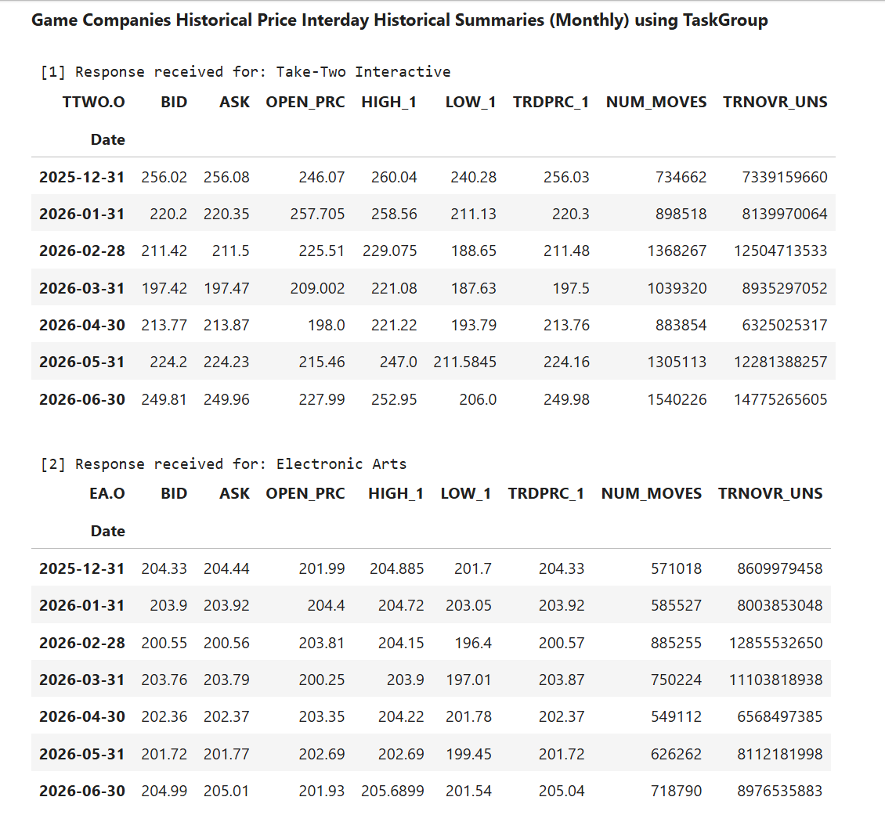

Please be noticed that when developers send multiple Historical Pricing Definition with **a single RIC** request, each RIC gets its own data response grouping together sequently in a Python *list* returns from `historical_data = [task.result() for task in tasks]` statement.

```python
print(f" Data type is {type(historical_data)} and length is {len(historical_data)}")
```

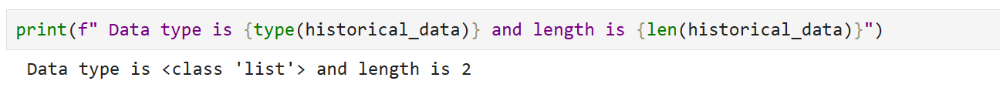

An application can iterate each result from the returned list (as shown in the `display_response_taskgroup` method) or use the following statement to get data from its closure.

```python
next(
    response.data.df
    for response in historical_data
    if getattr(response, "closure", None) == "Take-Two Interactive"
)
```

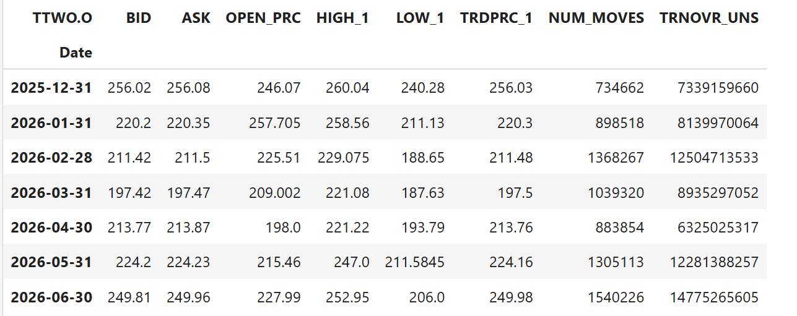

#### Understanding asyncio.TaskGroup Code

Before proceeding, let me explain more about the basic of Asyncio TaskGroup Python code above.

The code shows a basic example of using `asyncio.TaskGroup` to run multiple Historical Pricing module `.get_data_async(...)` requests concurrently in one managed block.

In the example code, each `(ric, company)` request is one task. Running them together is usually faster than running them one-by-one.

##### Why use TaskGroup

`TaskGroup` provides structured concurrency: tasks are created inside a single managed `async with` block and are awaited together when the block exits.

This is a strong fit for strict batch workflows. If one task fails, `TaskGroup` cancels unfinished sibling tasks and raises the failures as one `ExceptionGroup`.

##### What this code is doing

1. Create one async request per `(ric, company)` pair using `historical_pricing.summaries.Definition(...).get_data_async(...)`.
2. Add each coroutine to the group with `tg.create_task(...)`.
3. Let `async with asyncio.TaskGroup()` wait until all tasks complete (or are cancelled).
4. After the block exits, every task is either finished or cancelled due to an error.

After the `TaskGroup` block exits, use this statement to read the returned data.

```python
historical_data = [task.result() for task in tasks]
```

##### Error handling (simple)

- Keep the TaskGroup block inside `try/except* LDError`.
- Call `task.result()` only after the TaskGroup block exits.
- The helper `display_response_taskgroup(...)` methods show each response safely with defensive display pattern.

That’s all I have to say about the basic form of Asyncio TaskGroup code Python code explanation.

### Can I use Historical Pricing Events and Summaries Definitions in the same Asyncio TaskGroup?

Yes, you can.  The idea is to prepare two separate groups of requests first:

- **Event requests** - these fetch recent trade and correction events for Boeing (*BA.N*).
- **Intraday summary requests** - these fetch 5-minute price bars over the date range for Lockheed Martin (*LTM.N*).

Both groups are built as lists of coroutines (pending async calls, not yet running). They are then merged into a single list called `all_coroutines`, keeping their original order.

Separating the setup from the execution makes the code easier to read and lets you confirm what will be requested before anything runs.

```python
# ── Event tasks (BA.N: Boeing) ─────────────────────────────────────────────
# Fetch the 10 most recent trade/correction events per instrument concurrently.
event_tasks = [
    historical_pricing.events.Definition(
            universe="BA.N",
            fields=EVENT_FIELDS,
            adjustments=EVENT_ADJUSTMENTS,
            count=10,
        ).get_data_async(
            closure="Boeing Historical Events"
        )
]

# ── Intraday summary tasks (LTM.N: Lockheed Martin) ───────────────────────────────────────
# Fetch 5-minute OHLC bars for the date range for the next 10 instruments.
intraday_summary_tasks = [
     historical_pricing.summaries.Definition(
            universe="LTM.N",
            fields=INTRADAY_FIELDS,
            interval=Intervals.FIVE_MINUTES,
            count=10
        ).get_data_async(
            closure=f"Lockheed Martin Historical Summaries ({Intervals.FIVE_MINUTES})"
        )
]

all_coroutines = [*event_tasks, *intraday_summary_tasks]
```

Once `all_coroutines` list is ready, the next cell runs everything at the same time using `asyncio.TaskGroup`.

- Unlike `asyncio.gather`, where you can pass mixed Data Library definitions to awaitables directly, `TaskGroup` works best when we first combine Event and Intraday Summary calls into one `all_coroutines` list and then create tasks from that list in a single run.
- Keeping them in one ordered list makes result handling easier: the first part of `historical_data` maps to Event results, and the second part maps to Intraday Summary results.

```python
# Run all requests concurrently.
# TaskGroup waits for every task before exiting the block.
try:
    # Execute all request coroutines concurrently with TaskGroup (Python 3.11+).
    # Structured concurrency ensures tasks finish (or are cancelled together)
    # before execution continues past the async-with block.
    async with asyncio.TaskGroup() as tg:
        tasks = [tg.create_task(coro) for coro in all_coroutines]

    # Keep results in task-creation order so [0:5] and [5:] map cleanly
    # to the event and intraday request groups.
    historical_data = [task.result() for task in tasks]

    display_response_taskgroup(historical_data)
except* LDError as errors:
    for error in errors.exceptions:
        print(error)
```

The code above does the following:

- `async with asyncio.TaskGroup() as tg` creates a managed task group.
- `tg.create_task(coro)` schedules each coroutine to run.
- The `async with` block does not exit until **every** task in the group has finished (or failed). There is no need to call `await` manually.

Once the block exits, you can collect the results with `task.result()` in task-creation order.

If one task raises `LDError`, TaskGroup cancels the remaining tasks and the `except*` block reports the error.

The Historical data from the above requests is as follows:

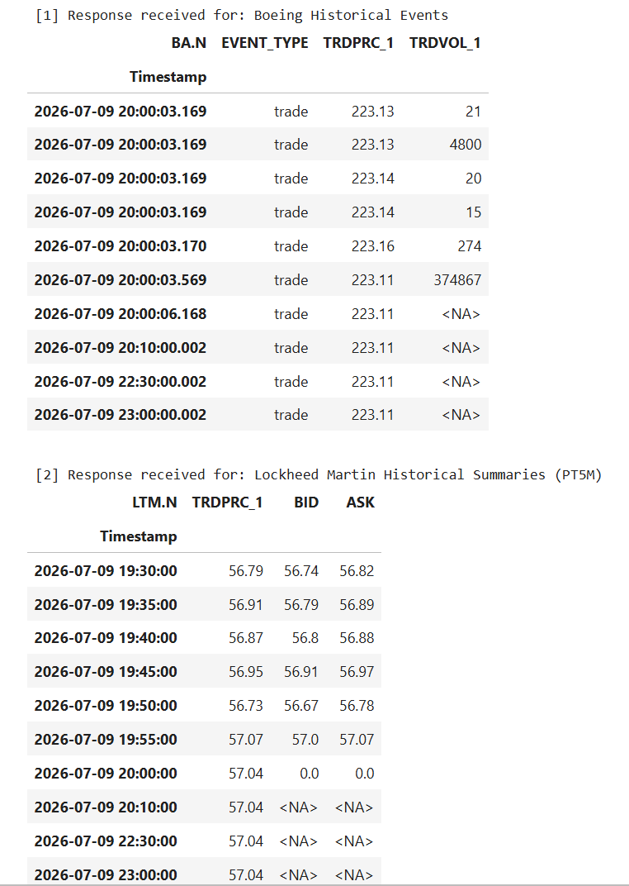

### Requesting Data with Request Limits

Moving on to the next topic, how to set up the requests throttle.

Like `asyncio.gather()`, we can use `asyncio.TaskGroup` with [`asyncio.Semaphore`](https://docs.python.org/3/library/asyncio-sync.html#asyncio.Semaphore) to limit the number of in-flight requests (that we are grouping) at any given time (default: 3).

If you are requesting only 2-10 RICs, the backend can usually handle the load without issue. As the number of simultaneous requests grows to 50, 100, or more, a semaphore becomes essential for staying within the platform's rate limits (see the **Rate Limit** section in the README). The following example demonstrates this pattern with 20 RICs.

**The semaphore pattern is recommended when requesting a large number of instruments from the platform.**

```python
# ── Demo universe for semaphore-throttled TaskGroup requests ─────────────────
artemis_ii = {
    "LTM.N": "Lockheed Martin",
    "BA.N": "Boeing",
    "NOC.N": "Northrop Grumman",
    "LHX.N": "L3Harris Technologies",
    "AIR.PA": "Airbus",
}

# Convert dictionary items to (RIC, company) pairs so each request can carry a readable label.
list_of_artemis_ii_companies = list(artemis_ii.items())

# Keep only 2 in-flight requests at a time to demonstrate throttling.
semaphore = asyncio.Semaphore(2)

async def fetch_summaries_throttle(ric, company, fields, interval,count):
    """Request historical summaries for one RIC with semaphore throttling."""
    # Semaphore enforces max concurrent requests across all created coroutines.
    async with semaphore:
        return await historical_pricing.summaries.Definition(
            universe=ric,
            fields=fields,
            interval=Intervals.MONTHLY,
            start=START,
            end=END,
            count=count,
        ).get_data_async(
            closure=f"{company} Historical Summaries ({interval})"
        )

# Build request coroutines; TaskGroup in the next cell schedules them concurrently.
interaday_summary_tasks = [
    fetch_summaries_throttle(ric, company, INTERDAY_FIELDS, Intervals.MONTHLY, count=5)
    for ric, company in list_of_artemis_ii_companies
]
```

Once the semaphore-protected coroutines are ready, the next step is to schedule them as tasks using `asyncio.TaskGroup` as I have demonstrated previously.

```python
# Run all requests concurrently.
# TaskGroup waits for every task before exiting the block.
try:
    # Execute all request coroutines concurrently with TaskGroup (Python 3.11+).
    # Structured concurrency ensures tasks finish (or are cancelled together)
    # before execution continues past the async-with block.
    async with asyncio.TaskGroup() as tg:
        tasks = [tg.create_task(coro) for coro in interaday_summary_tasks]

    # Keep results in task-creation order cleanly
    # to the event and intraday request groups.
    historical_data = [task.result() for task in tasks]
    display(Markdown("**Artemis II involved Companies Historical Price Events using TaskGroup and Semaphore**"))
    display_response_taskgroup(historical_data)
except* LDError as errors:
    for error in errors.exceptions:
        print(error)
```

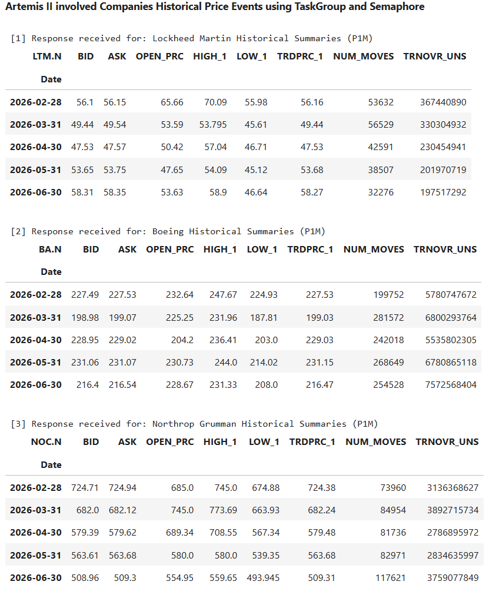

#### Understanding asyncio.TaskGroup with asyncio.Semaphore

So, now let’s look at how to use asyncio.TaskGroup with asyncio.Semaphore in detail.

An application can uses `asyncio.TaskGroup` with `asyncio.Semaphore` to run many requests safely.

##### Where Semaphore fits

If you start too many requests at once, you may hit HTTP **429 Too Many Requests**.
A semaphore prevents that by limiting how many requests are in-flight at the same time.

##### How it works

Only *N* coroutines can enter the protected section at once. The rest wait.

```
asyncio.Semaphore(N)  ->  at most N HTTP requests in-flight at any time
```

##### Key points

- Create the semaphore once, outside the helper function.
- Put `await get_data_async(...)` inside `async with semaphore:`.
- The semaphore limits request concurrency per coroutine, while `TaskGroup` creates and waits for all tasks.
- Start with a small limit (for example 5-10) and lower it if you still see 429 errors.

##### What `fetch_summaries_throttle` helper method does

The method uses `historical_pricing.summaries.Definition(...)` to request summary bars for one instrument. The key important thing is the method runs inside `async with semaphore:` so request concurrency is limited for each coroutine.

Semaphore controls how many requests run at once; TaskGroup manages the task lifecycle.

### Can I use different Definitions in the same Asyncio TaskGroup with a Semaphore?

Yes. The only additional step is to wrap each request in `async with semaphore` through a helper function; the rest of the TaskGroup pattern remains the same.

```python
REQUEST_LIMITS = 5
semaphore = asyncio.Semaphore(REQUEST_LIMITS)

# Convert dictionary items to (RIC, company) pairs so each request can carry a readable label.
list_of_sp500_companies = list(INSTRUMENTS.items())

async def fetch_events_throttle(ric, company, fields, count):
    """Request event data for one RIC with semaphore throttling."""
    async with semaphore:
        return await historical_pricing.events.Definition(
            universe=ric,
            fields=fields,
            adjustments=EVENT_ADJUSTMENTS,
            count=count,
        ).get_data_async(
            closure=f"{company} Historical Events"
        )

# ── Event tasks (INSTRUMENTS[0:10]) ─────────────────────────────────────────────
# Fetch the 10 most recent trade/correction events per instrument concurrently.
event_tasks = [
    fetch_events_throttle(ric, company, EVENT_FIELDS, 10)
    for ric, company in list_of_sp500_companies[:10]
]

# ── Intraday summary tasks (INSTRUMENTS[20:30]) ───────────────────────────────────────
# Fetch 5-minute OHLC bars for the date range for the next 10 instruments.
intraday_summary_tasks = [
    fetch_summaries_throttle(ric, company, INTRADAY_FIELDS, Intervals.FIVE_MINUTES, count=5)
    for ric, company in list_of_sp500_companies[20:30]
]

# ── Flatten all coroutines into a single ordered list ──────────────────────────────
# The next cell executes them concurrently via asyncio.TaskGroup (Python 3.11+).
all_coroutines = [*event_tasks, *intraday_summary_tasks]
```

#### What `fetch_summaries_throttle` helper method does?

The method uses `historical_pricing.events.Definition(...)` to request event-level data for one instrument. Like the `fetch_summaries_throttle` method above, it also runs inside `async with semaphore:` so request concurrency is limited for each coroutine.

```python
# Run all requests concurrently.
# TaskGroup waits for every task before exiting the block.
try:
    # Execute all request coroutines concurrently with TaskGroup (Python 3.11+).
    # Structured concurrency ensures tasks finish (or are cancelled together)
    # before execution continues past the async-with block.
    async with asyncio.TaskGroup() as tg:
        tasks = [tg.create_task(coro) for coro in all_coroutines]

    # Keep results in task-creation order so [0:5] and [5:] map cleanly
    # to the event and intraday request groups.
    historical_data = [task.result() for task in tasks]
    display(Markdown("**Companies Historical Price Events using TaskGroup**"))
    display_response_taskgroup(historical_data[:10])
except* LDError as errors:
    for error in errors.exceptions:
        print(error)
```

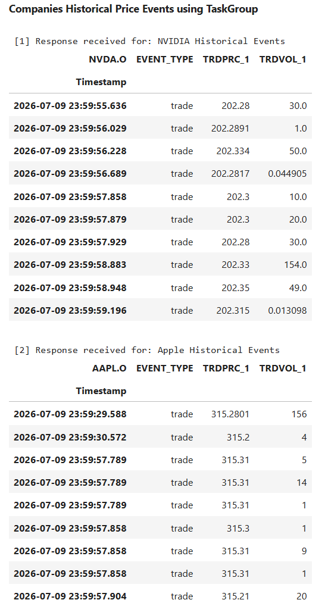

```python
try:
    display(Markdown("**Companies Intraday Daily Historical Summaries (5-Minute Intervals) using TaskGroup**"))
    display_response_taskgroup(historical_data[10:])
except* LDError as errors:
    for error in errors.exceptions:
        print(error)
```

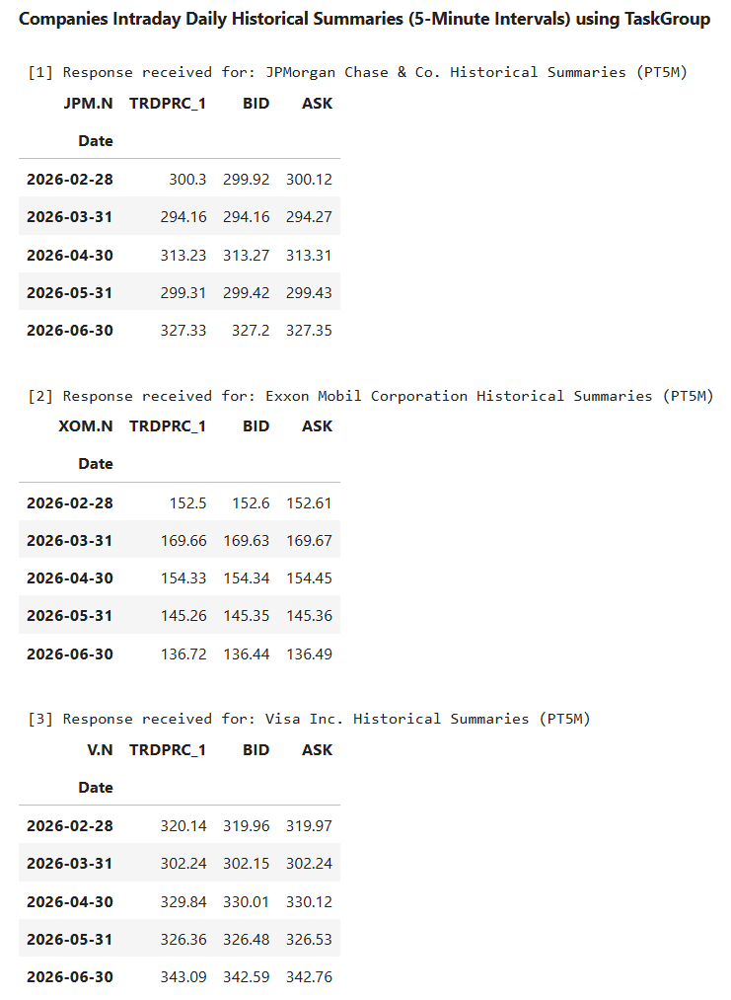

Let’s leave the requests throttle there.

### How Does TaskGroup Handle Errors?

Now, what about the TaskGroup and the Errors which is a big different between the TaskGroup and `asyncio.gather`. 

The TaskGroup uses a **fail-fast** approach. If one task raises an error, TaskGroup cancels the remaining tasks and raises an `ExceptionGroup`. This means the whole batch operation fails as a unit instead of returning partial results to the application.

**Note**: This error-handling example uses only a small number of RICs, so `asyncio.Semaphore` is not required in this section.

#### Invalid and Non-Permission RIC Requests

The example below demonstrates two error cases:

- an invalid RIC: `INVALIDRIC.O`
- a non-permission RIC: `ASML.AS` (permission may vary by user account)

This shows how TaskGroup stops the overall operation when one or more requests fail.

```python
invalid_instrument_cases = {"IBM.N":"IBM","INVALIDRIC.O": "Invalid Instrument","JPM.N":"JPMorgan Chase & Co.","ASML.AS": "ASML"}

# Convert dictionary items to (RIC, company) pairs so each request can carry a readable label.
list_of_rics_companies_with_errors = list(invalid_instrument_cases.items())
data_with_ric_errors = []

# Run one daily-summary request per instrument at the same time.
# TaskGroup waits for all tasks to finish before moving on.
try:
    async with asyncio.TaskGroup() as tg:
        tasks = [
            tg.create_task(
                historical_pricing.summaries.Definition(
                    universe=ric,              # RIC symbol, e.g. "GOOG.O"
                    fields=INTERDAY_FIELDS,
                    interval=Intervals.DAILY,
                    start=START,
                    end=END,
                    count=10             # Max number of records to return; adjust as needed
                ).get_data_async(
                    closure=f"{company} Interday Historical Summaries (Daily)"
                )
            )
            for ric, company in list_of_rics_companies_with_errors
        ]

    data_with_ric_errors = [task.result() for task in tasks]
    display(Markdown("**Companies Intraday Daily Historical Summaries (Daily) using TaskGroup with Errors**"))
    display_response_taskgroup(data_with_ric_errors)
except* LDError as errors:
    for error in errors.exceptions:
        print(f"Exception: {error}")
```

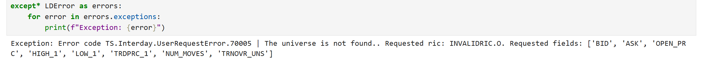

As you can see, once the library encounters an error, it raises an exception and immediately marks the entire operation as failed. The error message is not added to the result list because TaskGroup raises the exception as soon as the failure occurs.

Please note that the execution order is **not guaranteed**, so you might get another error first when you run this code.

```python
len(data_with_ric_errors)
```

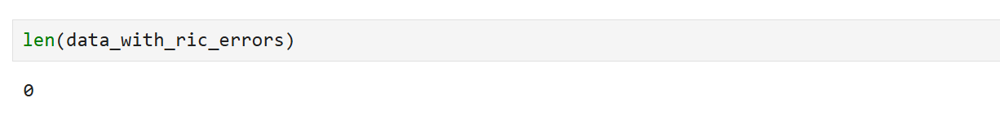

#### Invalid Fields

Now let's see how the library handles invalid fields with the `asyncio.TaskGroup`.

```python
EVENT_FIELDS_WITH_INVALID = EVENT_FIELDS + ["INVALID_FIELD"]  # Invalid field to demonstrate error handling
try:
    # Create a concurrent batch of event requests for the first three instruments.
    # The star-unpack passes each coroutine as a separate argument to gather.

    async with asyncio.TaskGroup() as tg:
        tasks = [
            tg.create_task(
                historical_pricing.events.Definition(universe="VOD.L", fields=EVENT_FIELDS_WITH_INVALID, count=5).get_data_async(closure="Vodaphone")
            )
        ]

    data_with_fields_error = [task.result() for task in tasks]

    # Display a section header before printing each response output.
    display(Markdown("**Companies Historical Price Events with RIC error**"))
    # Show each response DataFrame on success; otherwise print the HTTP status code.
    display_response_taskgroup(data_with_fields_error)
except* LDError as errors:
    for error in errors.exceptions:
        print(error)
```

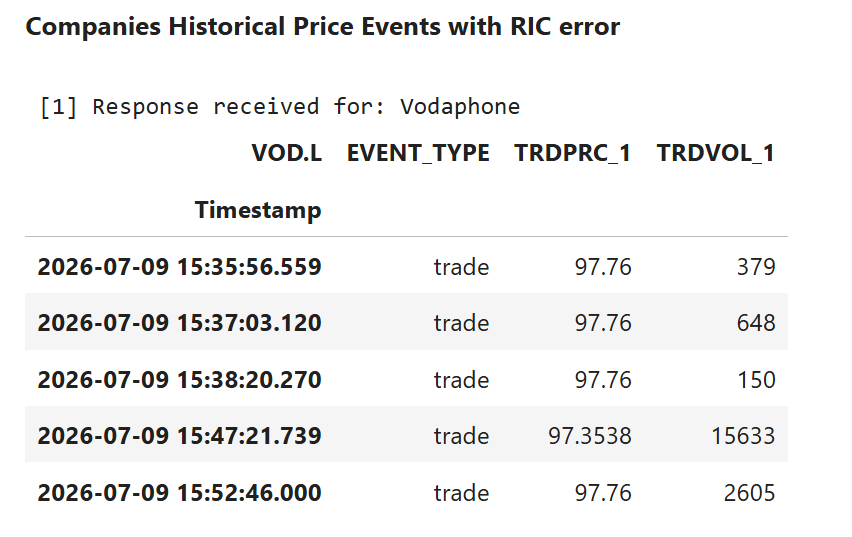

The library and backend can handle a mix of valid and invalid fields by ignoring the invalid ones and returning data for the valid fields.

With `asyncio.TaskGroup`, a request that mixes valid and invalid fields can still complete successfully.

You can use the `response.data.raw` statement to check what error that cause the fields are invalid.

```python
data_with_fields_error[0].data.raw
```

```json
{'universe': {'ric': 'VOD.L'},
 'adjustments': ['exchangeCorrection', 'manualCorrection'],
 'defaultPricingField': 'TRDPRC_1',
 'qos': {'timeliness': 'delayed'},
 'headers': [{'name': 'DATE_TIME', 'type': 'string'},
  {'name': 'EVENT_TYPE', 'type': 'string'},
  {'name': 'TRDPRC_1', 'type': 'number', 'decimalChar': '.'},
  {'name': 'TRDVOL_1', 'type': 'number', 'decimalChar': '.'}],
 'data': [['2026-07-09T15:52:46.000000000Z', 'trade', 97.76, 2605],
  ['2026-07-09T15:47:21.739000000Z', 'trade', 97.3538, 15633],
  ['2026-07-09T15:38:20.270000000Z', 'trade', 97.76, 150],
  ['2026-07-09T15:37:03.120000000Z', 'trade', 97.76, 648],
  ['2026-07-09T15:35:56.559000000Z', 'trade', 97.76, 379]],
 'status': {'code': 'TS.Intraday.UserRequestError.90006',
  'message': 'The universe does not support the following fields: [INVALID_FIELD].'},
 'meta': {'blendingEntry': {'headers': [{'name': 'COLLECT_DATETIME',
     'type': 'string'},
    {'name': 'RTL', 'type': 'number', 'decimalChar': '.'},
    {'name': 'SOURCE_DATETIME', 'type': 'string'},
    {'name': 'SEQNUM', 'type': 'string'}],
   'data': [['2026-07-10T04:00:09.757000000Z',
     6304,
     '2026-07-10T04:00:09.757000000Z',
     '171']]}}}
```

**Please note that if a request contains only invalid fields (either one invalid field or a list of all invalid fields), the request fails and raises an exception.**

### Last Question: Can I make Asyncio TaskGroup return both successful results and errors?

In theory, yes—you can handle this programmatically. However, using `asyncio.gather(..., return_exceptions=True)` is usually much easier and keeps the code simpler for that requirement.

That’s all I have to say about how Asyncio TaskGroup manages errors.

### Close the Session

Now we come to the last section of the code, you can close the session with the following statements.

```python
# Close the session to release resources; in a long-running application, consider keeping the session open and reusing it for subsequent API calls instead.
ld_session.close()
ld.close_session()
```

That brings me to the end of the Data Library Asynchronous methods with Asyncio TaskGroup code walkthrough.

## So, Which One Should I Use: Asyncio Gather or TaskGroup for Data Library?

Now let’s get to the main question: which approach should you use?

There isn’t a single right answer. Both Asyncio Gather and TaskGroup are good options. The best choice depends on how you want your application to behave when something goes wrong.

### Quick answer

- Use `TaskGroup` when requests should succeed or fail together, and you want safer, structured error handling.
- Use `asyncio.gather(..., return_exceptions=True)` when you want more flexible behavior, especially if you need to keep partial successes even when some requests fail.

### How they differ in practice

| Area | `asyncio.gather` | `asyncio.TaskGroup` |
|---|---|---|
| Main idea | Run many awaitables and collect results | Run many tasks in one managed group |
| Result handling | Returns a result list directly | Keep task references and call `.result()` |
| Error behavior | Configurable with `return_exceptions` | Fail-fast by design |
| Partial success support | Strong, especially with `return_exceptions=True` | Limited, because one failure cancels remaining tasks |
| Safety and structure | Flexible but easier to misuse in complex flows | Strong structured concurrency, easier to reason about |
| Best for | Mixed outcomes, reporting all responses | All-or-nothing operations |

### Tradeoffs

#### `asyncio.gather` advantages

- Simple for batching and collecting results in one line.
- With `return_exceptions=True`, you can process successful and failed responses together.
- Useful when your app should continue even if some instruments fail.

#### `asyncio.gather` limitations

- Error behavior depends on options and can be confusing in larger workflows.
- Without careful handling, failed tasks can make control flow harder to follow.

#### `TaskGroup` advantages

- Clear lifecycle: tasks are created, managed, and completed within one block.
- Fail-fast behavior is safer for operations that must stay consistent.
- Better for production flows where cleanup and predictable control flow matter.

#### `TaskGroup` limitations

- More verbose: you must keep task references and extract results manually.
- Not ideal when partial results are the goal, because one failure cancels sibling tasks.

### Performance vs Asyncio.Gather

In practice, `asyncio.TaskGroup` can show *a slight performance advantage* over `asyncio.gather` in some Python 3.11+ workloads, partly due to improvements in task management and structured concurrency. However, the difference are micro-level and irrelevant.

That said, performance depends on workload characteristics and runtime conditions, so results may vary. Please check a direct comparison examples using Data Library Historical Pricing `historical_pricing.summaries.Definition` definition with 30 RICs on [30 RICs with TaskGroup](./ld_notebook_taskgroup_performance.ipynb) and [30 RICs with Gather](./ld_notebook_gather_performance.ipynb) notebooks.

Please note that both examples measure retrieval time only, excluding display overhead.

**Historical Pricing get_data_async with Asyncio.Gather Performance**

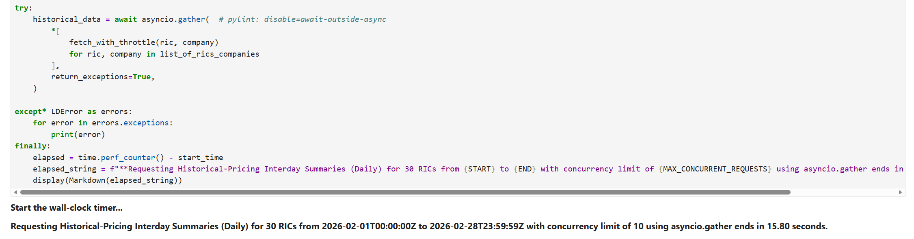

**Data Library Get History Synchronous Performance**

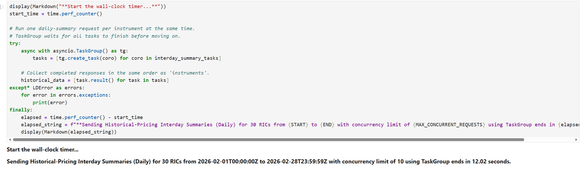

### Recommended choice for Data Library scenarios

Choose `asyncio.gather(..., return_exceptions=True)` when:

1. You are exploring data from many RICs.
2. You want to keep successful responses even if some requests fail.
3. You need one combined list of successes and errors for reporting.

Choose `TaskGroup` when:

1. You are running a strict batch job.
2. The whole operation should stop if any request fails.
3. You want clearer, safer concurrency structure.

### Practical rule of thumb

- If you want best-effort results: use `asyncio.gather(..., return_exceptions=True)`.
- If you want all-or-nothing correctness: use `asyncio.TaskGroup`.
- For both approaches, if you are sending many requests at once: add `asyncio.Semaphore(...)` to limit in-flight requests and reduce the chance of HTTP 429 errors.

That covers all I wanted to say today.

